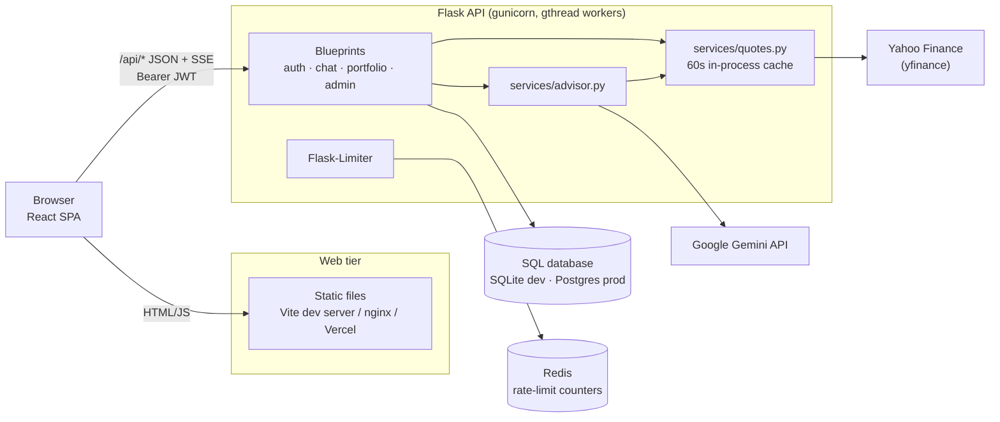
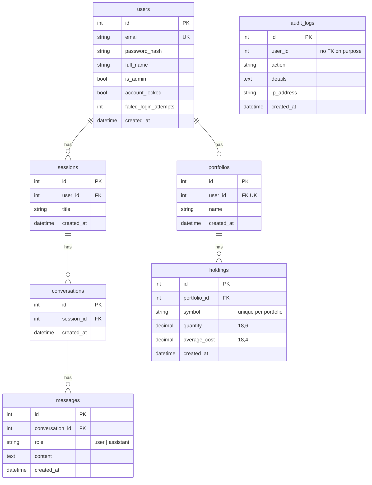
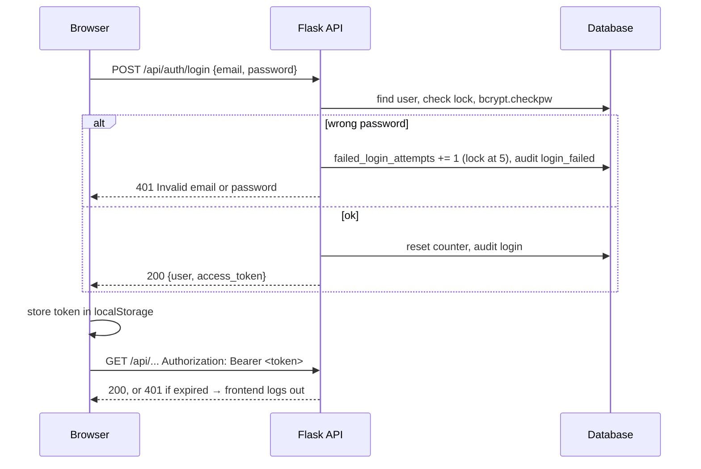
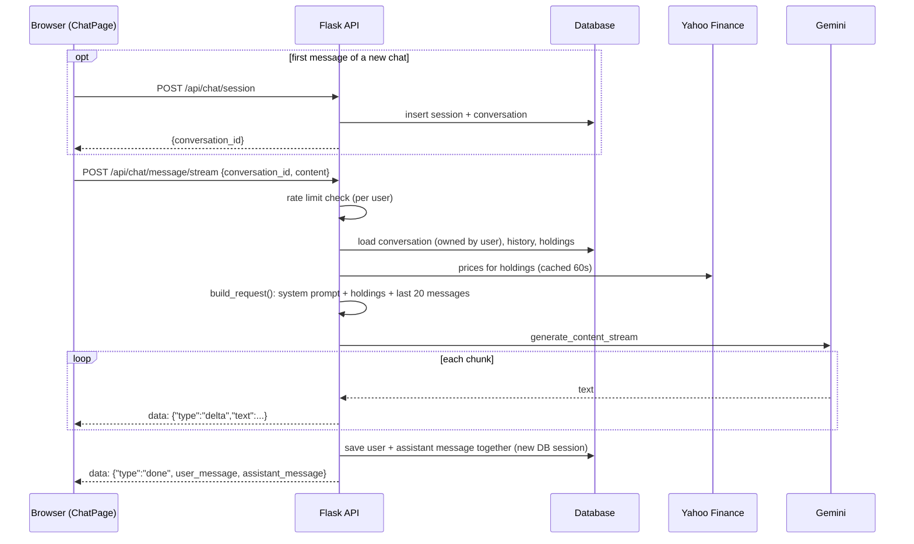
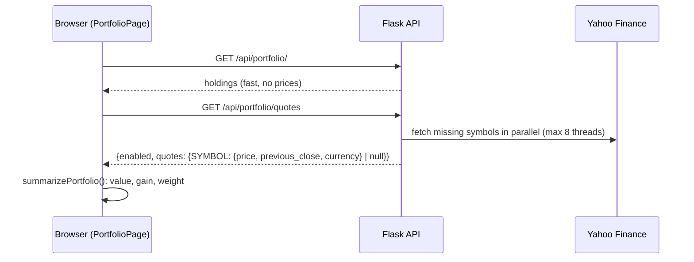

# Architecture

**Purpose:** How the system fits together: components, data model, and what happens on each important request.

## Overview

The app is a React single-page app talking to a Flask JSON API. The API stores users, chats and portfolios in a SQL database, calls Google Gemini for advisor replies, and fetches live prices from Yahoo Finance. Rate-limit counters live in Redis in production.

## Table of Contents

- [System diagram](#system-diagram)
- [Environments](#environments)
- [Database schema](#database-schema)
- [API overview](#api-overview)
- [Authentication flow](#authentication-flow)
- [Chat data flow](#chat-data-flow)
- [Portfolio and prices](#portfolio-and-prices)
- [Caching and shared state](#caching-and-shared-state)

## System diagram

## Environments

| | Development | Docker Compose | Production (planned) |
|---|---|---|---|
| Frontend | Vite dev server, `:5173` | nginx container, `:8080` | Vercel |
| How `/api` is reached | Vite proxy → `127.0.0.1:5000` | nginx `proxy_pass` → `backend:5000` | `VITE_API_URL` → Render URL (cross-origin, CORS) |
| Backend | `python main.py` (Flask debug server) | gunicorn | gunicorn on Render |
| Database | SQLite `backend/instance/dev.db` | Postgres 17 container | Supabase Postgres |
| Rate-limit storage | `memory://` | Redis container | Render Key Value (Redis) |
| `TRUSTED_PROXY_COUNT` | 0 | 1 | 1 |

There is no separate staging environment.

## Database schema

Notes:

- Every parent → child relationship uses `cascade="all, delete-orphan"`, so deleting a chat session removes its conversations and messages.
- `audit_logs.user_id` is a plain integer with no foreign key, so audit history survives if a user is deleted.
- The session model is called `ChatSession` in Python (table `sessions`) to avoid confusion with SQLAlchemy's `db.session`.
- A portfolio is created lazily the first time a user opens it or adds a holding. Each user has at most one.
- The UI currently uses one conversation per session. The schema allows several, which is why chat endpoints take a `conversation_id`.
- Schema changes go through Alembic migrations in `backend/migrations/`. `tests/test_migrations.py` fails if models and migrations drift apart.

## API overview

All routes are under `/api`. Full details with examples are in [API.md](API.md).

| Prefix | Endpoints | Auth |
|---|---|---|
| `/api/health` | health check | none |
| `/api/auth` | register, login, me | none for register/login, JWT for `me` |
| `/api/chat` | create/list/delete sessions, send message (plain or streamed), history | JWT |
| `/api/portfolio` | get portfolio, live quotes, add/update/delete holding | JWT |
| `/api/admin` | list users, unlock user, audit logs | JWT + `is_admin` |

## Authentication flow

Tokens are HS256 JWTs signed with `JWT_SECRET_KEY`, with the user ID (as a string) as the subject. They expire after 1 hour and there is no refresh token: the user logs in again. See [SECURITY.md](SECURITY.md).

## Chat data flow

The frontend uses the streaming endpoint. What happens when a user sends a message:

Key points:

- **All or nothing.** The user's message and the reply are committed in one transaction after the reply finishes. If Gemini fails, nothing is saved and the client receives an `error` event; the frontend puts the typed text back in the input box.
- **The database session closes early.** A real WSGI server closes the request's DB session before the streaming generator runs, so `stream_message` reads everything it needs (history, holdings, prices) up front through `advisor.build_request`, and saves in a fresh session at the end.
- **Retries.** Gemini 429 and 5xx errors are retried after 1s and 3s (`GEMINI_RETRY_DELAYS`). A stream is retried only if no text has reached the user yet.
- **History cap.** Only the last `CHAT_HISTORY_LIMIT` (20) messages are sent to Gemini.
- **Session titles.** An untitled session is named after the first 60 characters of its first message.

## Portfolio and prices

Holdings and prices are separate calls so the table appears immediately while prices load. Unknown symbols or Yahoo failures return `null` for that symbol, and the UI values those holdings at cost. Portfolio math happens in the browser (`frontend/src/portfolio.ts`).

## Caching and shared state

| What | Where it lives | Notes |
|---|---|---|
| Stock prices | In-process dict, 60s TTL | Per gunicorn worker; not shared. Fine for this load. |
| Rate-limit counters | `RATELIMIT_STORAGE_URI` | `memory://` in dev. Must be Redis with several workers or instances, otherwise each worker has its own allowance. |
| Gemini client | Module-level singleton | Created on first use. |
| JWT | Browser `localStorage` (`advisor_token`) | Stateless on the server. |

## See Also

- [BACKEND.md](BACKEND.md) for the code behind these flows
- [FRONTEND.md](FRONTEND.md) for the client side
- [SECURITY.md](SECURITY.md) for auth details

---
**Last Updated:** 2026-10-13
**Status:** Complete
