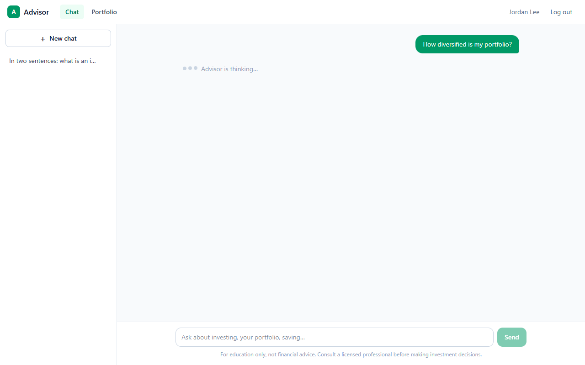
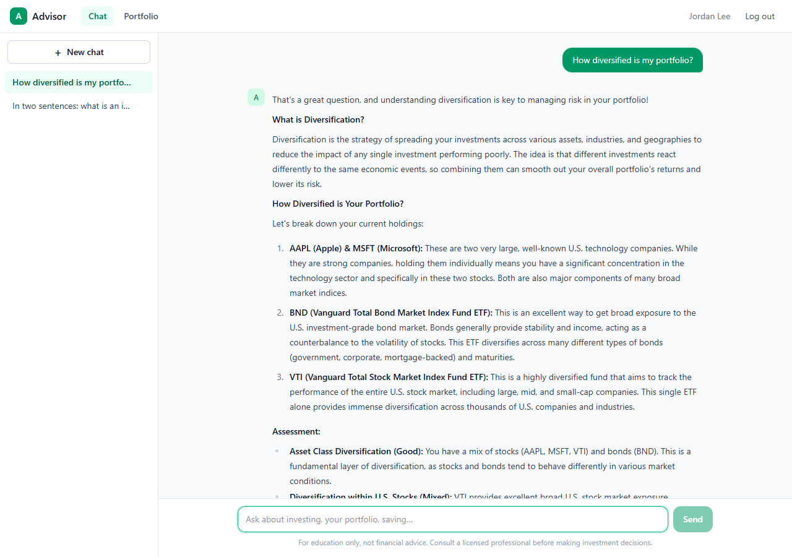
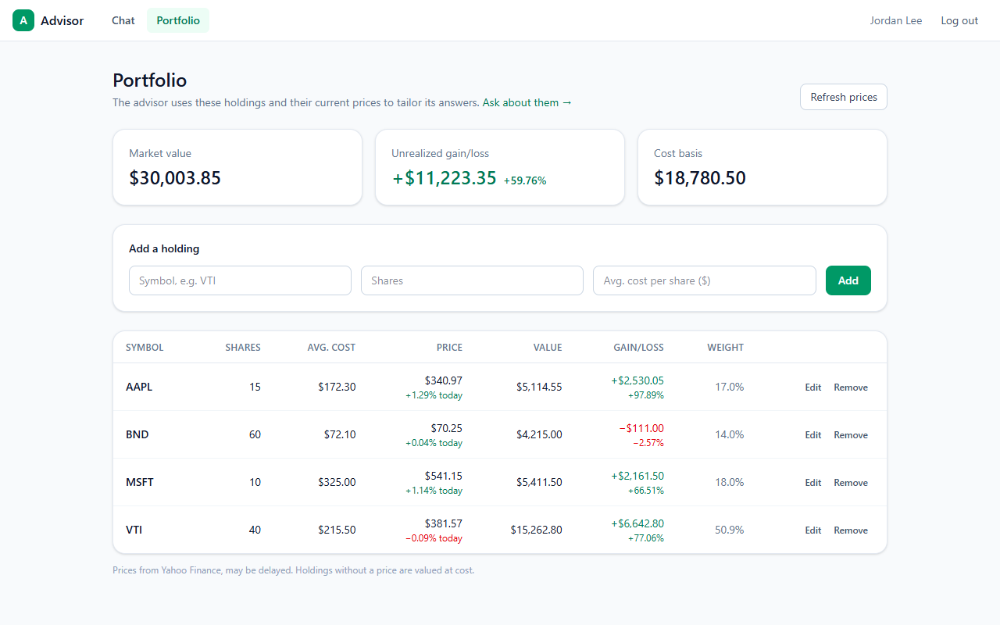
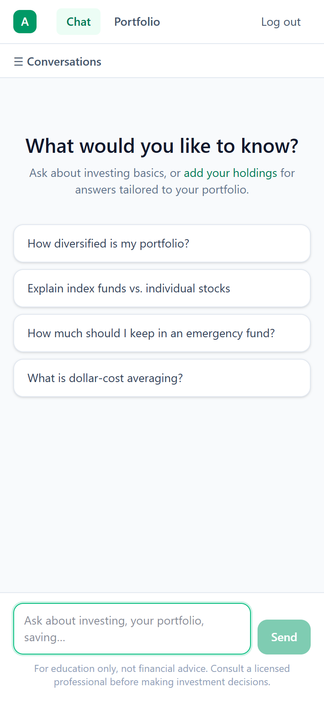

# Frontend

**Purpose:** Guide to the React app in `frontend/`: structure, routing, state, streaming and styling.

## Overview

A React 19 + TypeScript single-page app built with Vite 8, routed with React Router 8 and styled with Tailwind CSS v4. It has four screens (auth, chat, portfolio, admin) and no global state library: auth state lives in a React context and each page keeps its own state.

## Table of Contents

- [File structure](#file-structure)
- [Routing](#routing)
- [API client](#api-client)
- [Authentication](#authentication)
- [Chat page](#chat-page)
- [Portfolio page](#portfolio-page)
- [Admin page](#admin-page)
- [Styling](#styling)
- [Build and environment](#build-and-environment)

## File structure

```
frontend/
├── index.html
├── vite.config.ts          # React + Tailwind plugins, /api dev proxy
├── vitest.config.ts        # jsdom test environment
├── nginx.conf              # Used by the Docker image: static files + /api proxy
├── vercel.json             # SPA rewrite for Vercel
├── Dockerfile              # node:24 build → nginx:1.29
└── src/
    ├── main.tsx            # Mounts <App />
    ├── App.tsx             # Routes per role
    ├── api.ts              # Typed API client, ApiError, SSE parsing, streamMessage
    ├── auth.tsx            # AuthProvider / useAuth
    ├── portfolio.ts        # summarizePortfolio(): value, gain, weight math
    ├── index.css           # Tailwind v4 config (@import "tailwindcss", typography plugin)
    ├── components/
    │   └── Layout.tsx      # Top bar with nav and log out
    ├── pages/
    │   ├── AuthPage.tsx    # Login and register (mode prop)
    │   ├── ChatPage.tsx    # Sidebar of chats, messages, streaming input
    │   ├── PortfolioPage.tsx
    │   └── AdminPage.tsx   # Users tab and audit log tab
    └── test/
        ├── setup.ts
        └── fakeServer.ts   # fetch stub for tests
```

There are no separate `hooks/` or `utils/` folders; small helpers live next to the component that uses them.

## Routing

`App.tsx` renders a different route set depending on who is logged in, instead of guarding each route:

| State | Routes | Anything else |
|---|---|---|
| Checking token | "Loading…" screen | |
| Logged out | `/login`, `/register` | → `/login` |
| User | `/chat/:conversationId?`, `/portfolio` | → `/chat` |
| Admin | the above + `/admin` | → `/chat` |

Chat uses **one route with an optional parameter** so the page doesn't remount when a new chat receives its ID and the URL changes from `/chat` to `/chat/12`.

## API client

All HTTP goes through `src/api.ts`:

- `api` object with one typed method per endpoint (`api.login`, `api.portfolio`, `api.streamMessage`, ...).
- Base URL is `import.meta.env.VITE_API_URL ?? '/api'`.
- Adds `Authorization: Bearer <token>` when a token is stored.
- Throws `ApiError(status, message, details)` for non-2xx responses and network failures. `err.friendlyMessage` gives the first field validation message, e.g. `"password: Length must be between 8 and 128."`.
- A 401 while logged in calls the handler registered by `AuthProvider`, which logs the user out and shows "Your session expired".

```ts
try {
  const { holding } = await api.addHolding('VTI', '10', '215.50')
} catch (err) {
  setError(err instanceof ApiError ? err.friendlyMessage : 'Could not add holding')
}
```

## Authentication

`src/auth.tsx` provides `useAuth()` → `{ user, loading, sessionExpired, login, register, logout }`.

- The JWT is stored in `localStorage` under `advisor_token`.
- On page load, if a token exists, `GET /api/auth/me` validates it. If that fails, the token is cleared.
- `logout()` only clears local state; tokens are stateless and expire after 1 hour.

## Chat page

`src/pages/ChatPage.tsx`:

- **Sidebar** lists sessions (`GET /chat/sessions`) with a delete button each, and **New chat**. On mobile it becomes a drawer opened with **☰ Conversations**.
- **Lazy session creation:** a session is created only when the first message is sent, so empty chats don't pile up.
- **Streaming:** `api.streamMessage(id, content, onDelta)` reads the SSE body with a `TextDecoderStream`, splits events with `parseSSE`, calls `onDelta` per chunk, and resolves on `done` or throws on `error`.
- **Optimistic message:** the user's bubble appears immediately with a temporary negative ID and is replaced by the saved messages on `done`. On error it is removed and the text goes back into the input.
- **Race protection:** `activeIdRef` holds the conversation currently on screen. It is set *before* `navigate()` because router navigation is a transition, and a fast reply could otherwise be treated as belonging to a different chat and dropped.
- Replies are rendered as Markdown with `react-markdown` and `prose` classes.
- **Enter** sends; **Shift+Enter** inserts a newline. Max 4000 characters.

| Waiting | Answer |
|---|---|
|  |  |

## Portfolio page

`src/pages/PortfolioPage.tsx`:

- Loads holdings (`GET /portfolio/`) and prices (`GET /portfolio/quotes`) separately.
- Re-fetches prices only when the *set of symbols* changes, not on quantity edits.
- `latestQuoteRequest` ref ignores out-of-order quote responses, so a slow old response can't overwrite a newer one.
- `summarizePortfolio()` in `src/portfolio.ts` computes per-row value, gain, gain %, day change and weight, and totals. Holdings without a price are valued at cost and excluded from gain.
- Rows support inline edit and two-step delete (Remove → Delete / Keep).



## Admin page

`src/pages/AdminPage.tsx` has two tabs, each paged 50 per page by the shared `usePaged` hook:

- **Users:** email, name, join date, status, **Unlock** for locked accounts.
- **Audit log:** filter by action; failure and lock events are highlighted.

## Styling

- Tailwind CSS v4 via `@tailwindcss/vite`, configured in `src/index.css` (no `tailwind.config.js`).
- `@tailwindcss/typography` (`prose` classes) for Gemini's Markdown.
- Palette: slate neutrals with emerald as the accent color.
- Responsive: the chat sidebar collapses below the `md` breakpoint and the top bar hides the name below `md`.



## Build and environment

```bash
npm run dev      # dev server on :5173 with /api proxy
npm run build    # tsc -b (includes tests) then vite build → dist/
npm run lint     # oxlint
npm test         # vitest
npm run preview  # serve dist/ locally
```

| Variable | When | Meaning |
|---|---|---|
| `VITE_API_URL` | build time | API base URL, e.g. `https://advisor-api-xxxx.onrender.com/api`. Default `/api`. |
| `API_PROXY_TARGET` | dev server | Where `/api` is proxied. Default `http://127.0.0.1:5000`. |

`VITE_API_URL` is baked into the bundle at build time, so changing it requires a rebuild.

## See Also

- [API.md](API.md) for the endpoints the client calls
- [TESTING.md](TESTING.md#frontend-tests) for the frontend tests
- [USER_GUIDE.md](USER_GUIDE.md) for the screens from a user's point of view

---
**Last Updated:** 2026-10-13
**Status:** Complete
