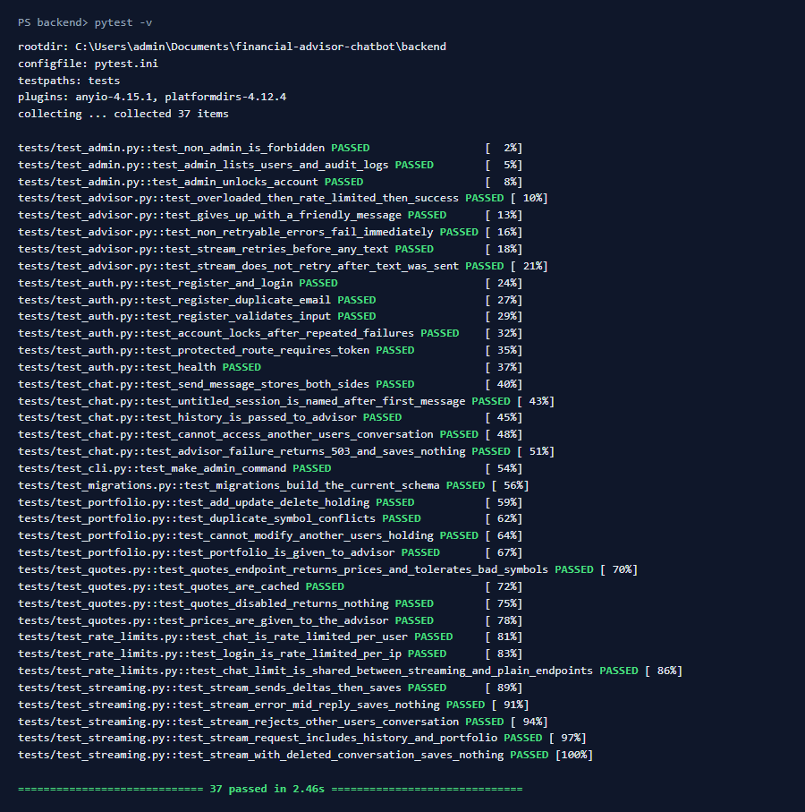
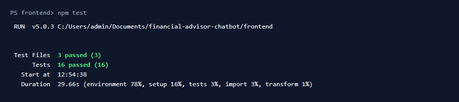

# Testing

**Purpose:** How to run the tests, what they cover, and how external services are faked.

## Overview

There are two automated suites: **37 backend tests** (pytest) and **16 frontend tests** (Vitest), plus a lint step and a PowerShell smoke test that runs against a live server. CI runs the automated suites on every push and pull request. Neither suite calls Gemini or Yahoo Finance.

## Table of Contents

- [Running the tests](#running-the-tests)
- [Latest results](#latest-results)
- [Backend tests](#backend-tests)
- [Frontend tests](#frontend-tests)
- [Mocking external services](#mocking-external-services)
- [Smoke test against a live server](#smoke-test-against-a-live-server)
- [CI pipeline](#ci-pipeline)
- [Coverage and load testing](#coverage-and-load-testing)
- [Writing a new test](#writing-a-new-test)

## Running the tests

Backend, from `backend/` with the venv active:

```bash
pytest                                                        # all
pytest -v                                                     # list each test
pytest tests/test_chat.py                                     # one file
pytest tests/test_chat.py::test_history_is_passed_to_advisor  # one test
pytest -k lock                                                # by name match
```

Frontend, from `frontend/`:

```bash
npm test                        # vitest run
npx vitest run -t "streamed"    # tests whose name matches
npx vitest                      # watch mode
npm run lint                    # oxlint
npm run build                   # also type-checks the tests (tsc -b)
```

## Latest results

Captured 2026-10-13 on the development machine.

Backend: **37 passed in 2.46s**



Frontend: **16 passed** in 3 files



Lint (`npm run lint`): 0 errors, 3 warnings (`only-export-components` in `auth.tsx`, `set-state-in-effect` in `ChatPage.tsx` and `PortfolioPage.tsx`).

## Backend tests

Each test gets a fresh app with `create_app("testing")`: in-memory SQLite, bcrypt with 4 rounds, quotes disabled, retry delays of zero, and in-memory rate limits.

| File | Tests | Covers |
|---|---|---|
| `test_auth.py` | 6 | Register + login, duplicate email (409), validation (400), lockout after 5 failures, token required, health |
| `test_chat.py` | 5 | Both messages saved, session titled from first message, history passed to the advisor, other users' conversations return 404, Gemini failure → 503 with nothing saved |
| `test_streaming.py` | 5 | SSE deltas then `done` and save, mid-stream error saves nothing, ownership, request includes history and portfolio, conversation deleted mid-stream |
| `test_advisor.py` | 5 | Retry on 503 then 429 then success, friendly message after retries run out, non-retryable errors fail at once, streams retry only before any text |
| `test_portfolio.py` | 4 | Add / update / delete, duplicate symbol (409), other users' holdings return 404, holdings given to the advisor |
| `test_quotes.py` | 4 | Quotes endpoint tolerates bad symbols, caching, disabled quotes, prices included in the advisor prompt |
| `test_rate_limits.py` | 3 | Chat limited per user, login limited per IP, one allowance shared by both message endpoints |
| `test_admin.py` | 3 | Non-admin gets 403, admin lists users and logs, unlock |
| `test_cli.py` | 1 | `make-admin` grant and revoke |
| `test_migrations.py` | 1 | Running all migrations produces exactly the current models' schema |

Shared fixtures are in `tests/conftest.py`: `app`, `client`, `register` (creates a user, returns `(user_id, auth headers)`, optionally admin), `fake_advisor`, `fake_stream` and `parse_sse`.

## Frontend tests

Vitest with jsdom and Testing Library.

| File | Tests | Covers |
|---|---|---|
| `src/App.test.tsx` | 6 | Login error shown; login lands on chat; new conversation shows streamed reply; failed send keeps the typed text and shows the error; portfolio value and gain; slow outdated quote response is ignored |
| `src/api.test.ts` | 7 | `parseSSE` (partial events, CRLF); `streamMessage` (split chunks, error event, JSON error before stream); 401 triggers logout; first validation detail as friendly message |
| `src/portfolio.test.ts` | 3 | Valuation with and without prices, sorting, empty portfolio |

## Mocking external services

**Rule: tests never call Gemini or Yahoo.**

| Service | How it's faked |
|---|---|
| Gemini, plain | `fake_advisor` fixture replaces `app.routes.chat.generate_reply` with a canned reply and records the messages and portfolio it was given |
| Gemini, streaming | `fake_stream` fixture replaces `app.routes.chat.stream_reply`, yields two chunks, and records the request |
| Gemini SDK errors | `test_advisor.py` monkeypatches `advisor._get_client` with a fake client that raises `google.genai.errors` with chosen status codes |
| Yahoo Finance | `QUOTES_ENABLED = False` in tests; quote tests turn it on and monkeypatch `quotes._fetch_quote` |
| Backend (from the frontend) | `src/test/fakeServer.ts` replaces `fetch` with routes keyed by `"METHOD /path"`. Unmatched requests throw, so unexpected calls fail the test |

`fake_stream` calls `close_request_session()` before yielding. A real server closes the request's DB session before the streamed body runs, but Flask's test client doesn't, so without this a test could pass while production fails.

Frontend example:

```ts
fakeServer({
  'GET /auth/me': () => json({ user }),
  'POST /chat/session': () => json({ session, conversation_id: 7 }, 201),
  'POST /chat/message/stream': () =>
    eventStream([sse({ type: 'delta', text: 'Hello' }), sse({ type: 'done', user_message, assistant_message })]),
})
```

## Smoke test against a live server

`backend/scripts/smoke_test.ps1` exercises a running server end to end, **including one real Gemini call**. It checks: server is up, register, login, add holdings, chat with Gemini, chat history is saved, missing token (401), non-admin (403) and wrong password (401). Each check prints PASS or FAIL.

```powershell
cd backend
.\scripts\smoke_test.ps1                                    # dev server
.\scripts\smoke_test.ps1 -BaseUrl http://localhost:8080/api  # Docker Compose
```

It creates a new random user each run, so run it against development or staging data only.

## CI pipeline

`.github/workflows/ci.yml`, on push to `main` and on pull requests:

| Job | Steps |
|---|---|
| `backend` | Python 3.13 → `pip install -r requirements.txt` → `pytest` |
| `frontend` | Node 24 → `npm ci` → `npm run lint` → `npm test` → `npm run build` |
| `docker` | `docker build backend` and `docker build frontend` |

## Coverage and load testing

- **Coverage:** not measured yet. To add it: `pip install pytest-cov` then `pytest --cov=app --cov-report=term-missing`; for the frontend, `npm i -D @vitest/coverage-v8` then `npx vitest run --coverage`. A reasonable first target is 80% of backend lines, with routes and `advisor.py` fully covered.
- **Load testing:** not set up. Chat throughput is bounded by the Gemini quota and by `CHAT_RATE_LIMIT`, so a load test should fake Gemini and focus on gunicorn worker and thread counts (`WEB_CONCURRENCY`, `GUNICORN_THREADS`) for concurrent streams.

## Writing a new test

```python
# backend/tests/test_portfolio.py
def test_symbol_is_uppercased(client, register):
    _, headers = register()
    response = client.post(
        "/api/portfolio/holding",
        json={"symbol": "vti", "quantity": "1", "average_cost": "200"},
        headers=headers,
    )
    assert response.status_code == 201
    assert response.get_json()["holding"]["symbol"] == "VTI"
```

Anything that would reach Gemini needs `fake_advisor` or `fake_stream` in the test's arguments.

## See Also

- [BACKEND.md](BACKEND.md#conventions) for the conventions the tests enforce
- [TROUBLESHOOTING.md](TROUBLESHOOTING.md) if a test fails locally

---
**Last Updated:** 2026-10-13
**Status:** Complete
