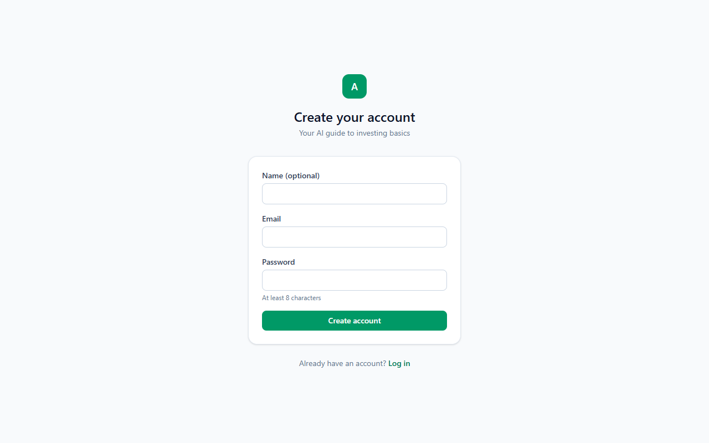
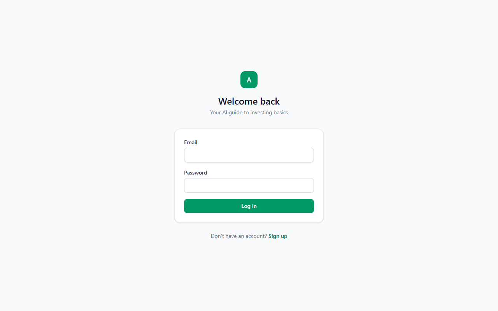
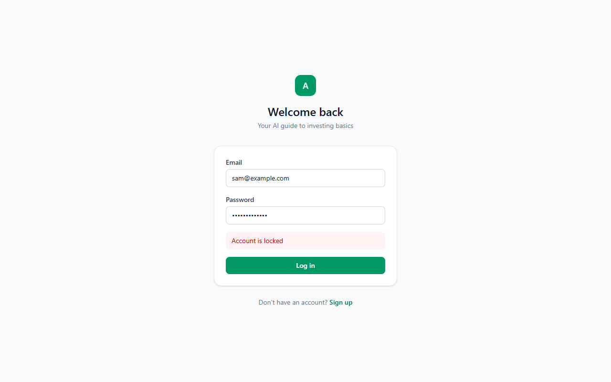
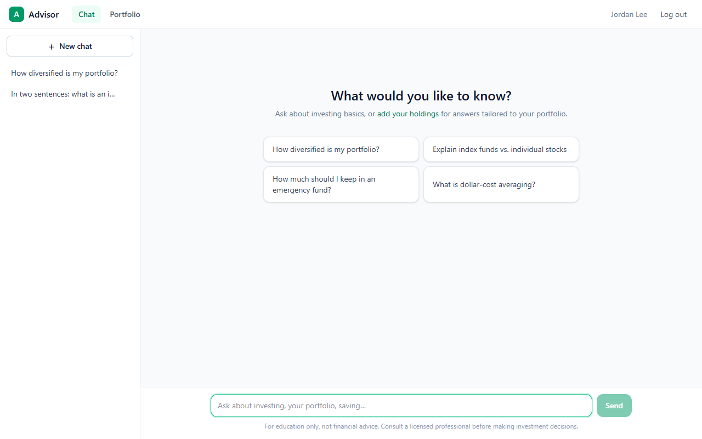
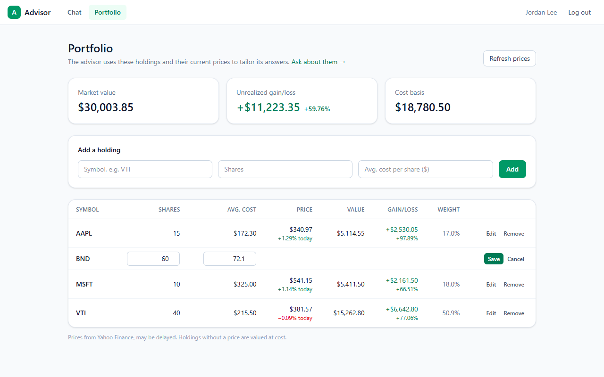
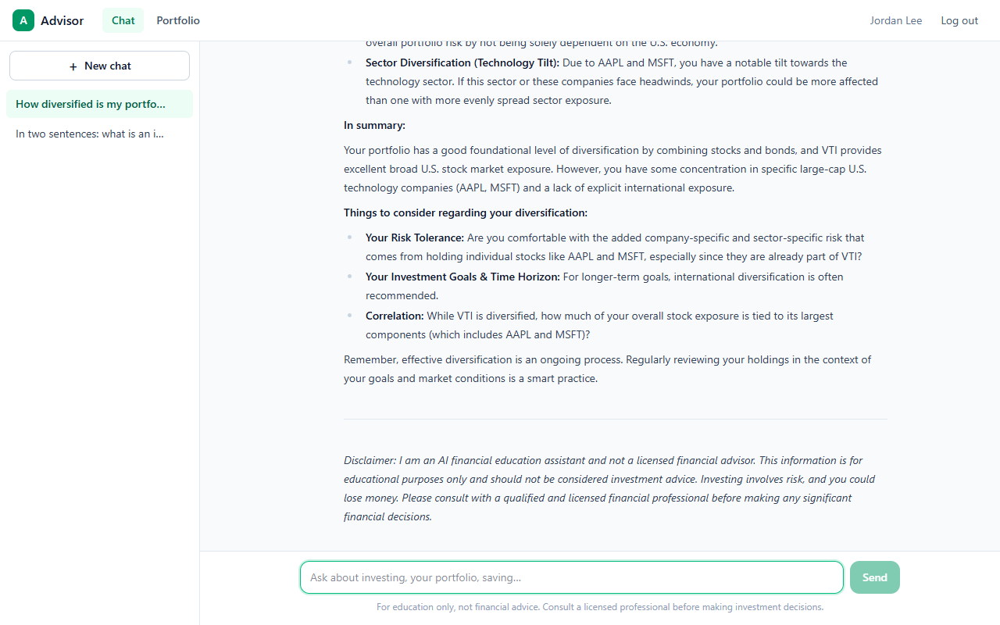
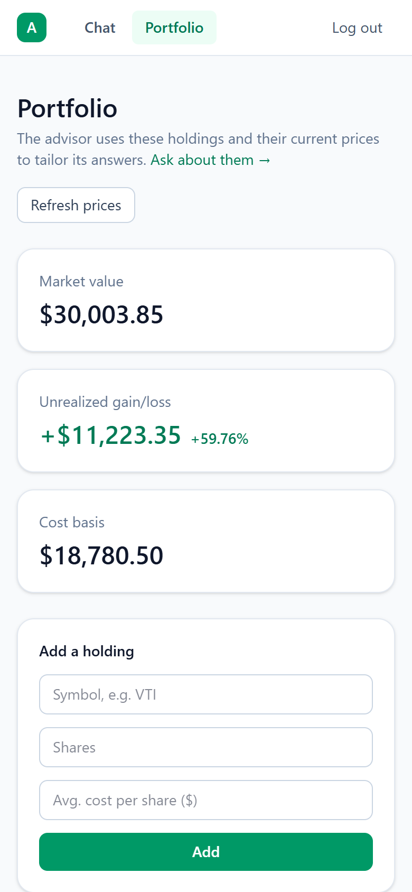
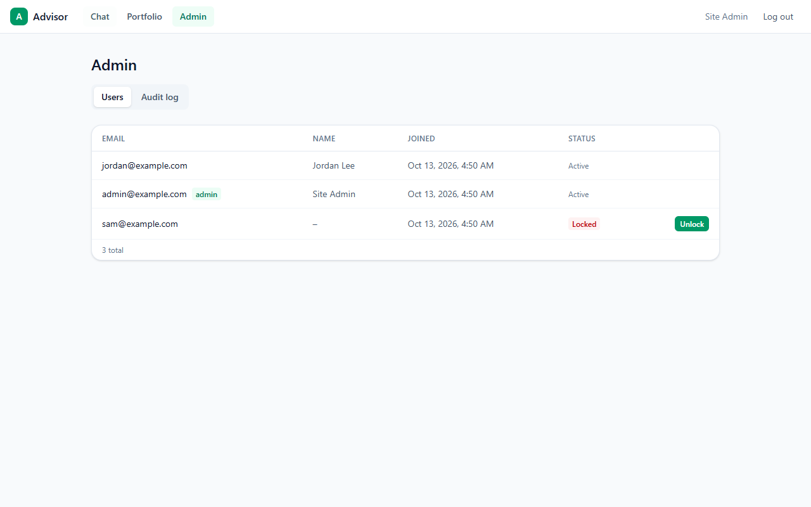
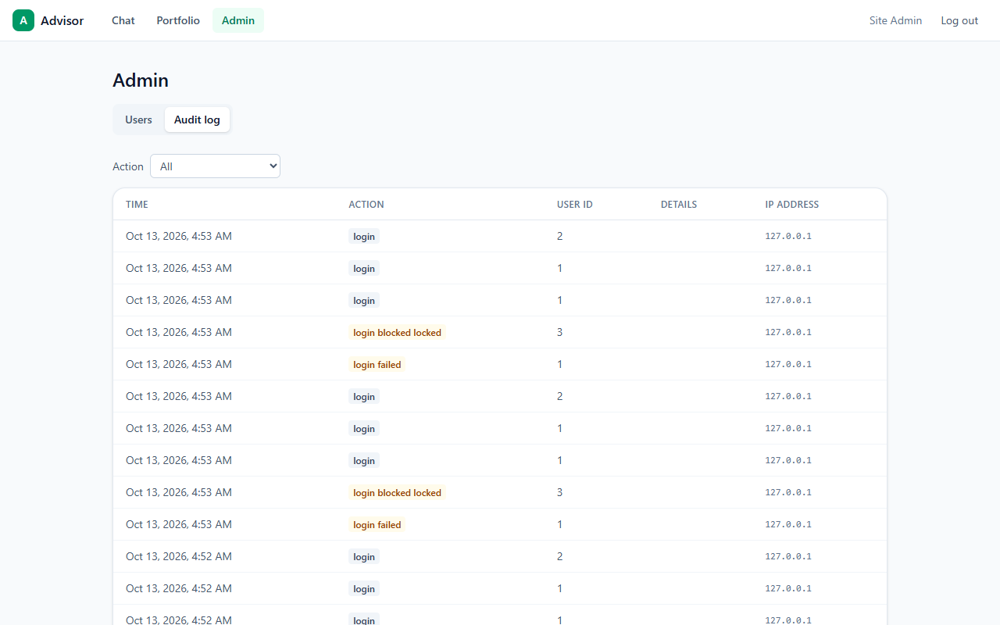

# User Guide

**Purpose:** How to use Advisor, the AI investing guide, step by step.

## Overview

Advisor is a chat assistant that explains investing in plain language. If you enter the stocks and funds you own, it takes them, and their current prices, into account when it answers. It's an educational tool: it does not give personal financial advice, and you should talk to a licensed professional before making big decisions.

## Table of Contents

- [Create an account](#create-an-account)
- [Log in](#log-in)
- [Chat with the advisor](#chat-with-the-advisor)
- [Manage your conversations](#manage-your-conversations)
- [Add your holdings](#add-your-holdings)
- [Read your portfolio](#read-your-portfolio)
- [Edit or remove a holding](#edit-or-remove-a-holding)
- [Understand the advisor's answers](#understand-the-advisors-answers)
- [On your phone](#on-your-phone)
- [Admin features](#admin-features)
- [FAQ](#faq)

## Create an account

1. Open the app and click **Sign up** under the login form.
2. Enter your email and a password of at least 8 characters. Your name is optional; it's shown in the top bar.
3. Click **Create account**. You're logged in straight away.

## Log in

Enter your email and password and click **Log in**.

- If you see **Invalid email or password**, check both and try again.
- After **5 wrong passwords in a row** your account is locked for safety and you'll see **Account is locked**. Contact an administrator to unlock it.
- You stay logged in for up to an hour. After that you'll see "Your session expired. Please log in again."

| Wrong password | Locked account |
|---|---|
|  |  |

## Chat with the advisor

1. Click **Chat** in the top bar.
2. Type a question in the box at the bottom, or click one of the suggestions to start.
3. Press **Enter** or click **Send**. Use **Shift+Enter** for a new line.

While the advisor works you'll see **Advisor is thinking…**, and then the answer appears word by word.

The advisor remembers the earlier messages in the same conversation, so you can ask follow-ups like "what would make it more diversified?".

Good questions to try:

- How diversified is my portfolio?
- Explain index funds vs. individual stocks
- How much should I keep in an emergency fund?
- What is dollar-cost averaging?
- What are the risks of holding individual tech stocks?

If something goes wrong (for example the AI service is busy), a red message appears above the input box and your question is put back so you can send it again.

## Manage your conversations

- Each chat is listed in the left sidebar, named after its first question. Click one to reopen it.
- **New chat** starts a fresh conversation.
- Hover over a chat in the sidebar and click **×** to delete it. There's no confirmation step, and the messages are removed permanently.

## Add your holdings

1. Click **Portfolio** in the top bar.
2. Under **Add a holding**, enter:
   - **Symbol**: the ticker, e.g. `VTI`, `AAPL`, `BND`. Non-US tickers use Yahoo's suffix, e.g. `SHOP.TO`.
   - **Shares**: how many you own (fractions are fine).
   - **Avg. cost per share ($)**: what you paid per share on average.
3. Click **Add**.

Each symbol can appear only once. To change the amount, edit the existing row.

## Read your portfolio

| Item | Meaning |
|---|---|
| **Market value** | What your holdings are worth at current prices |
| **Unrealized gain/loss** | Market value minus what you paid, in dollars and percent. "Unrealized" because you haven't sold |
| **Cost basis** | What you paid in total (shares × average cost) |
| **Price** | Latest price from Yahoo Finance, with today's change below it |
| **Value** | Shares × price |
| **Gain/loss** | Per holding, in dollars and percent |
| **Weight** | This holding's share of your total portfolio value |

- Green means up, red means down.
- Prices may be delayed. Click **Refresh prices** to update them (they're re-fetched at most once a minute).
- If a price can't be found, the row shows **n/a** and that holding is counted at what you paid.

## Edit or remove a holding

- **Edit**: change the shares or average cost, then **Save** (or **Cancel**).
- **Remove**: click it, then **Delete** to confirm or **Keep** to cancel.

## Understand the advisor's answers

- **It knows your portfolio.** Each answer is written with your current holdings and their live prices in view. In the example above it noticed the tech concentration from AAPL and MSFT, and that VTI already contains both.
- **It explains; it doesn't decide for you.** Expect explanations of concepts like diversification, risk, fees and time horizon, and questions to think about. It won't promise returns or tell you exactly what to buy.
- **It can be wrong.** AI models sometimes state things confidently that are out of date or incorrect. Check important facts, such as fund fees, with the fund provider.
- **Long answers can be cut off.** If an answer ends with *"(This answer was cut off because it hit the length limit.)"*, ask it to continue or to be shorter.
- **For education only.** The note under the chat box is a reminder: this is not financial advice. The advisor often ends longer answers with a summary, points to consider and a disclaimer of its own:

## On your phone

The app works on mobile browsers. On small screens the chat list moves behind **☰ Conversations**.

| Chat | Portfolio |
|---|---|
|  |  |

## Admin features

Administrators see an extra **Admin** tab.

**Users** lists every account with its join date and status. Locked accounts show a red **Locked** badge and an **Unlock** button; unlocking also resets the failed-password count.

**Audit log** shows sign-ups, logins, failed logins, blocked logins, unlocks and portfolio changes, with the time, user ID and IP address. Use the **Action** dropdown to filter, e.g. to see only failed logins. Failed and blocked events are highlighted in amber.

Admin rights are granted by whoever runs the server, with `flask --app main make-admin <email>`. Log out and back in afterwards to see the tab.

## FAQ

**Is this financial advice?**
No. It's an educational tool. Consult a licensed financial professional before making significant decisions.

**Who can see my portfolio and chats?**
Other users can't see them. In the app, administrators see your email, name and account activity: logins, and which symbols you added, changed or removed. They don't see your chat messages, share counts or costs. Your messages and holdings are sent to Google's Gemini AI to generate answers, and stock symbols are sent to Yahoo Finance to get prices.

**Do I need to enter my holdings?**
No. Without holdings you can still ask general questions; answers just won't be tailored to you.

**Why is a price missing or different from my broker's?**
Prices come from Yahoo Finance and can be delayed. A missing price usually means the symbol is unknown to Yahoo; check the ticker.

**I got "Too many requests".**
To keep the service fair there's a limit of 10 questions per minute and 200 per day. Wait a minute and try again.

**I forgot my password.**
There's no self-service reset yet. Ask an administrator.

**Can I delete my account?**
Not from the app yet. You can delete individual conversations and holdings; ask an administrator to remove the account.

**Can I connect my brokerage account?**
No. Holdings are entered by hand, and the app never asks for brokerage logins.

## See Also

- [TROUBLESHOOTING.md](TROUBLESHOOTING.md) if something isn't working

---
**Last Updated:** 2026-10-13
**Status:** Complete
